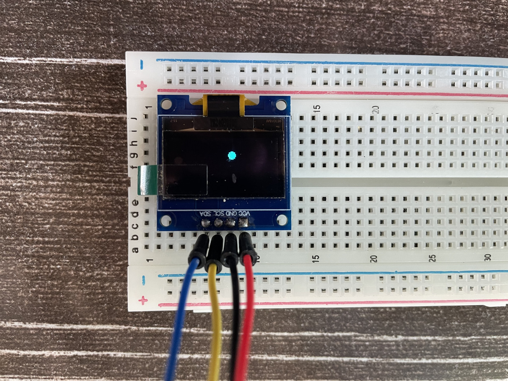

# Bouncing Ball on an OLED Display

A simple Arduino project that animates a ball bouncing around a 128×64 SSD1306 OLED screen. It is a good first project for learning how to drive an I2C display, draw shapes, and write a basic animation loop.



## Features

- Draws a filled circle on a 128×64 OLED
- Ball moves diagonally and bounces off all four screen edges
- Ball state (position, radius, speed) is stored in a simple `struct`
- Uses only 4 wires (I2C)

## Hardware

| Part | Notes |
|------|-------|
| Arduino board | Uno / Nano or similar |
| 0.96" OLED display | SSD1306, 128×64, I2C |
| Breadboard | |
| 4 jumper wires | |

## Wiring

| OLED Pin | Arduino Pin | Wire color (in photo) |
|----------|-------------|-----------------------|
| VCC | 5V (or 3.3V) | Red |
| GND | GND | Black |
| SCL | A5 (SCL) | Yellow |
| SDA | A4 (SDA) | Blue |

> A4/A5 are the I2C pins on the Uno and Nano. On other boards (Mega, Leonardo, ESP32, etc.) the SDA/SCL pins are different, so check your board's pinout.

## Libraries

Install these from the Arduino IDE Library Manager (`Sketch → Include Library → Manage Libraries`):

- **Adafruit SSD1306**
- **Adafruit GFX Library**

`Wire.h` is built in.

## Getting Started

1. Wire the display as shown above.
2. Open `bouncing_ball.ino` in the Arduino IDE.
3. Select your board and port under `Tools`.
4. Click **Upload**.
5. The ball should start bouncing on the screen.

If the screen stays blank, the I2C address may differ. This project uses `0x3C`, but some displays use `0x3D`. You can find yours with an I2C scanner sketch.

## How It Works

**1. Ball definition**

The ball is stored as a struct:

```cpp
struct Ball {
  int x;
  int y;
  int radius;
  int speedX;
  int speedY;
};

Ball ball = {20, 20, 4, 2, 1};   // x, y, radius, speedX, speedY
```

**2. Setup**

`setup()` starts the display at I2C address `0x3C`, clears it, and draws the first frame. If the display is not found, the program stops in an infinite loop.

**3. Animation loop**

Every pass through `loop()`:

1. Clear the screen
2. Draw the ball at its current position
3. Check whether the ball touches an edge, and if so reverse that axis's speed (`speed * -1`)
4. Move the ball by adding its speed to its position
5. Push the frame to the screen with `display.display()`

## Customization

| Change | How |
|--------|-----|
| Ball size | Change `radius` in `Ball ball = {...}` |
| Ball speed | Change `speedX` / `speedY` |
| Starting position | Change `x` / `y` |
| Smoother or slower animation | Add `delay(10);` at the end of `loop()` |

## Ideas for Next Steps

- Add a second ball
- Add a paddle and button input to make a Pong game
- Display a score or bounce counter with `display.print()`
- Add gravity so the ball falls and bounces with energy loss

## Full Code

```cpp
#include <Wire.h>
#include <Adafruit_GFX.h>
#include <Adafruit_SSD1306.h>

#define SCREEN_WIDTH 128
#define SCREEN_HEIGHT 64
#define OLED_RESET -1

Adafruit_SSD1306 display(
  SCREEN_WIDTH,
  SCREEN_HEIGHT,
  &Wire,
  OLED_RESET
);

// define ball
struct Ball {
  int x;
  int y;
  int radius;
  int speedX;
  int speedY;
};

// Create the ball object and set its starting values
Ball ball = {20, 20, 4, 2, 1};

void setup() {
  // Start the OLED
  if (!display.begin(SSD1306_SWITCHCAPVCC, 0x3C)) {
    while (true) {
      delay(10);
    }
  }

  display.clearDisplay();

  // draw the ball
  display.fillCircle(ball.x, ball.y, ball.radius, SSD1306_WHITE);

  display.display();
}

void loop() {
  display.clearDisplay();

  // draw the ball
  display.fillCircle(ball.x, ball.y, ball.radius, SSD1306_WHITE);

  // bounce off the screen edges
  if (ball.x + ball.radius >= SCREEN_WIDTH || ball.x - ball.radius <= 0) {
    ball.speedX = ball.speedX * -1;
  }

  if (ball.y + ball.radius >= SCREEN_HEIGHT || ball.y - ball.radius <= 0) {
    ball.speedY = ball.speedY * -1;
  }

  // move the ball
  ball.x += ball.speedX;
  ball.y += ball.speedY;

  display.display();
}
```

## License

MIT License. Feel free to use and modify.